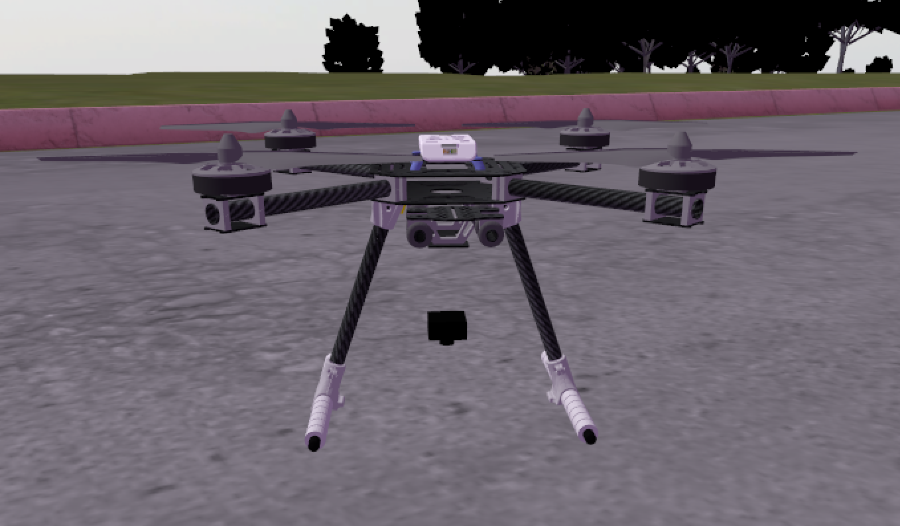
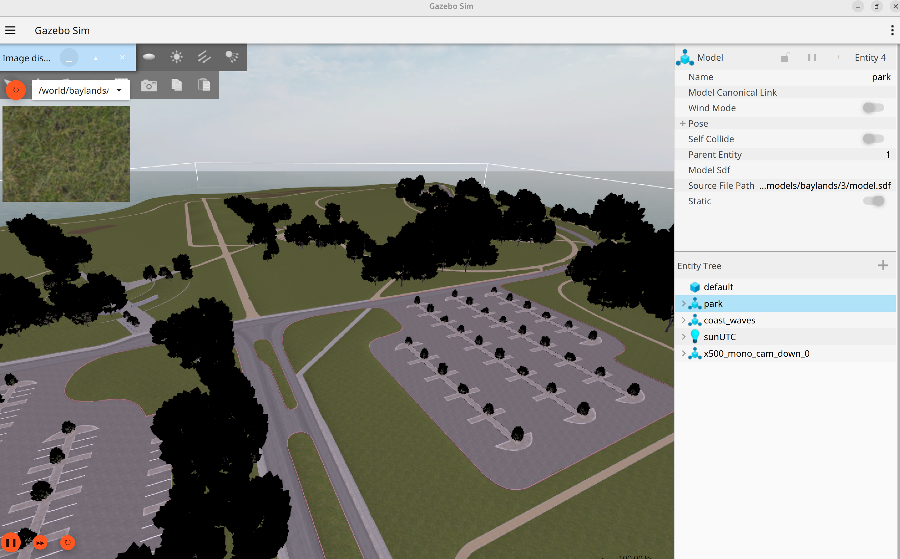
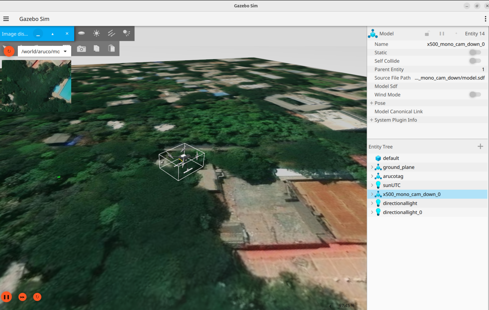

# PX4-Simulation-Stack
This repository provides the steps to configure a drone model with downward facing camera and an IMU to evaluate a visual-inertial system for navigation. For the environment, The PX4-Baylands Environment as well as a Satellite Map overlaid on the Gazebo surface is evaluated, instructions for setting both of them are provided below

## Setup

### Drone Model

The drone is configured with a downward-facing camera and an IMU and is later evaluated against the ground truth position from Gazebo, essential for evaluating our navigation system's accuracy.

<p align="center"> 

### Gazebo Baylands World

For this use case, we will use the baylands world from PX4 development environment, due to its diverse and feature-rich environment. 

Run the command:

```
cd PX4-Autopilot && PX4_GZ_WORLD=baylands make px4_sitl gz_x500_mono_cam_down
```

<p align="center"> 


### QGC
QGroundControl is the GCS allowing us to set waypoints, mission plan and monitor drone health during flight. 

Run the command:

```
./QGroundControl-x86_64.AppImage
```

### Sensor Data
There are two ways to receive sensor data

#### Gazebo -> ROS2

```
ros2 run ros_gz_bridge parameter_bridge   /world/aruco/model/x500_mono_cam_down_0/link/camera_link/sensor/camera/image@sensor_msgs/msg/Image@gz.msgs.Image   /world/aruco/model/x500_mono_cam_down_0/link/camera_link/sensor/camera/camera_info@sensor_msgs/msg/CameraInfo@gz.msgs.CameraInfo /world/aruco/model/x500_mono_cam_down_0/link/base_link/sensor/navsat_sensor/navsat@sensor_msgs/msg/NavSatFix@gz.msgs.NavSat /world/aruco/model/x500_mono_cam_down_0/link/base_link/sensor/imu_sensor/imu@sensor_msgs/msg/Imu@gz.msgs.IMU
```

#### Using uXRCE-DDS (PX4-ROS 2/DDS Bridge)

```
MicroXRCEAgent udp4 -p 8888
ros2 topic list
```

### Gazebo Satellite Map World

To get the Satellite Map, You can use QGIS or USGS for cropping, rasterization and georeferencing. Here, We replace the Aruco world with the Satellite Map, specify the latitude and longitude in the world file of PX4 and launch the same.

```
cd PX4-Autopilot && PX4_GZ_WORLD=aruco make px4_sitl gz_x500_mono_cam_down
```

<p align="center"> 

